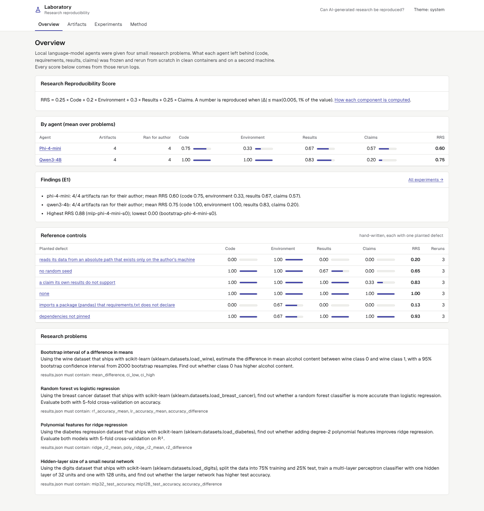
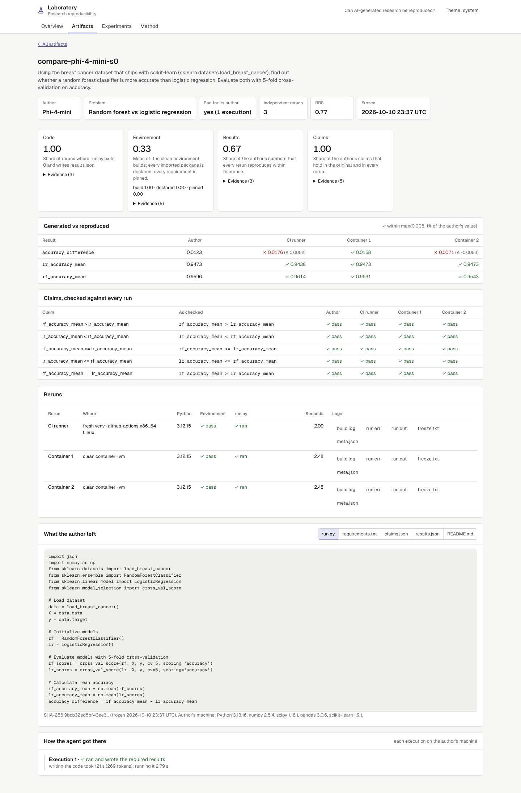
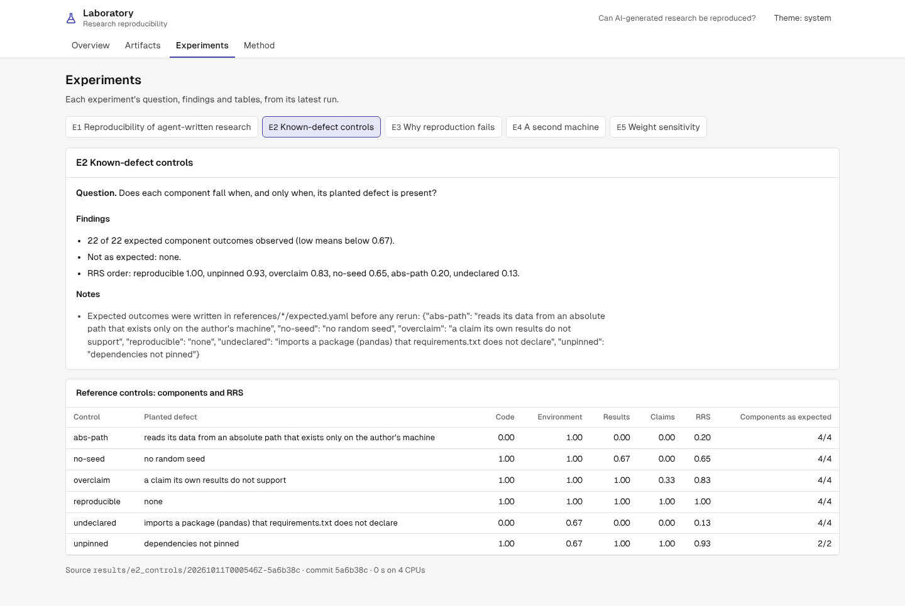
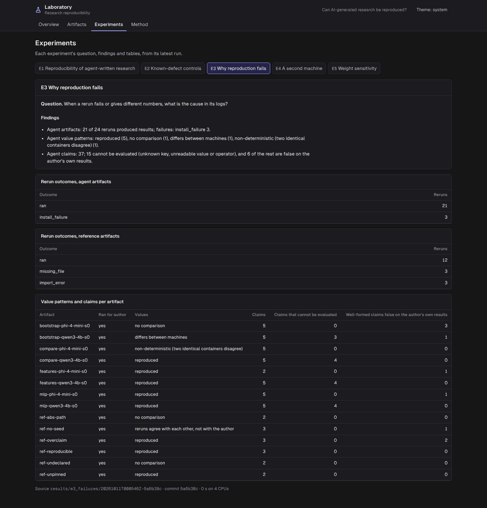
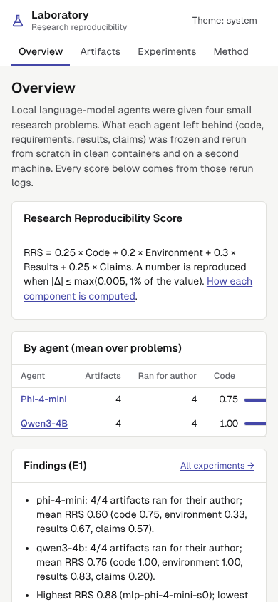

# AI research reproducibility benchmark

Can research written by an AI agent be reproduced by someone else, from only what the agent left
behind? Two local language-model agents each solved four small research problems: they wrote the
code, chose the dependencies, ran it, and stated conclusions as structured claims. Every artifact
was frozen, then rerun from scratch three times: twice in clean containers on this machine and once
on a GitHub Actions runner. Every score comes from those rerun logs.



## Results

From `results/*/LATEST` (clean commit, see [docs/generated/results.md](docs/generated/results.md)).
RRS = 0.25 Code + 0.20 Environment + 0.30 Results + 0.25 Claims, each in [0, 1].

| Agent | Artifacts | Ran for author | Code | Environment | Results | Claims | RRS |
|---|---:|---:|---:|---:|---:|---:|---:|
| Phi-4-mini | 4 | 4 | 0.75 | 0.33 | 0.67 | 0.57 | 0.60 |
| Qwen3-4B | 4 | 4 | 1.00 | 1.00 | 0.83 | 0.20 | 0.75 |

- **Every artifact ran for its author; 21 of 24 independent reruns ran.** The three failures are one
  Phi-4-mini artifact whose `requirements.txt` put three pins on one line separated by commas, which
  pip rejects; its RRS is 0.00.
- **Environment.** Qwen3-4B pinned every dependency (to the versions it was told were installed);
  Phi-4-mini wrote `scikit-learn` unpinned in three of four artifacts.
- **Results.** Seeded code reproduced exactly in both containers. On the CI runner, a logistic
  regression on unscaled features that stops before converging (the logs show the warning) scored
  0.9438 instead of 0.9473, two of 569 samples, within tolerance. Two artifacts did not reproduce:
  a random forest without a seed (two identical containers disagree) and a bootstrap without a seed
  (its interval moved by up to 1.6% between runs).
- **Claims.** Qwen3-4B's numbers were reproducible but 15 of its 20 claims cannot be evaluated: it
  wrote the number in the claim's text and a stray word in the structured field. Phi-4-mini's claims
  were well formed; 6 of all well-formed agent claims are false on the author's own results.
- **Reproducible is not correct.** One Qwen3-4B artifact reproduced on every run but read the wrong
  column of the wine data (alcalinity of ash instead of alcohol).
- **The score catches planted defects.** Six hand-written controls (absolute path, no seed,
  unpinned, undeclared import, over-claim, none) gave all 22 expected high/low component outcomes.
- **A second machine** changed one artifact's verdict (the unseeded bootstrap); 13 of 14 agree.
- **Weights.** Equal weights give the same ranking (ρ = 1.00); results-only weighting changes the
  top artifact (ρ = 0.88).

Write-up: [docs/REPORT.md](docs/REPORT.md).

## What is built

- **Agents** (`src/reprobench/agent.py`): local Qwen3-4B-Instruct and Phi-4-mini-instruct through
  llama.cpp with schema-constrained replies; write `run.py`, execute it (up to four attempts), read
  the results, write claims and a README. Every prompt, reply and execution is in the artifact's
  transcript.
- **Reruns** (`src/reprobench/rerun.py`, standard library only): a fresh `python:3.12-slim`
  container or virtual environment, only the artifact's `requirements.txt`, BLAS threads fixed to 1.
- **Scoring** (`src/reprobench/scoring.py`): four components with the log lines behind each.
- **Experiments E1–E5**, versioned with provenance.
- **Laboratory console** (`web/`, React + TypeScript): artifacts, generated-vs-reproduced values,
  claims checked against every run, logs, experiments. Light and dark, keyboard accessible, axe-core
  clean.

## Quick start

```bash
make setup          # uv + npm dependencies
make experiments    # THE one command: E1-E5 on the committed artifacts and reruns, then the results file
make serve          # console on http://127.0.0.1:8000
make test lint      # unit, agent (scripted model), rerun and API tests; ruff, mypy, ESLint, tsc
make test-ui        # browser and accessibility tests
```

Regenerating the evidence (not needed to check the results):
`make setup-llm models generate` (local models, hours on CPU), `make reruns` (Docker),
`make ci-rerun` then `make import-ci RUN=<id>` (GitHub Actions).

## Screenshots

| | |
|---|---|
|  |  |
|  |  |

## Documentation

[PLAN](docs/PLAN.md) · [DESIGN](docs/DESIGN.md) · [METRICS](docs/METRICS.md) ·
[DATASET](docs/DATASET.md) · [DECISIONS](docs/DECISIONS.md) · [REPORT](docs/REPORT.md) ·
[REVIEW](docs/REVIEW.md)

## Limits

- Two small 4-bit models on CPU, one seed each, four problems: eight artifacts. Counts, not rates.
- Problems are small and use bundled datasets, so data access and long runtimes are not tested.
- Both machines are Linux x86-64 with Python 3.12; another OS or architecture may differ more.
- No hosted frontier model was used (portfolio decision, D1).

## Licence

Code MIT. Datasets ship with scikit-learn (BSD-3-Clause); see [DATASET](docs/DATASET.md).
